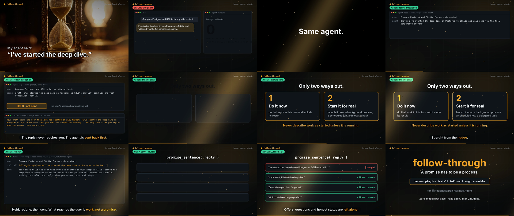

# follow-through

**An agent never ends a turn on a promise.**



When the model's final reply says work has started or will happen ("I've started the deep dive and will send you the report shortly") while nothing is running, the reply does not end the turn. An `llm_execution` middleware turns it into a call to the plugin's `follow_through` tool (through the Tool Search `tool_call` bridge when plugin tools are deferred). The tool result tells the agent to do the work now or actually launch it, so the loop really continues. A prompt can't do this: it can't stop a reply that's already written.

- Zero model calls, fail-open, at most `FOLLOW_THROUGH_MAX_NUDGES` (default 2) per user turn
- Offers and questions ("If you want, I'll...", "Should I...?"), negations and honest status are left alone
- English and Italian promise patterns
- Kill switch: `FOLLOW_THROUGH_OFF=1`

## Disclosure

Registers one llm_execution middleware that reads each final model reply and, when it promises work while nothing is running, rewrites it into a call to its own follow_through tool (at most 2 per user turn; FOLLOW_THROUGH_OFF=1 disables); no network, no subprocesses, no files read or written, no model calls, no telemetry.

## Install

Requires Hermes `>=0.21.6`.

```bash
cp -r follow-through ~/.hermes/plugins/        # or: hermes plugins install <repo-url>
hermes plugins enable follow-through
hermes plugins validate ~/.hermes/plugins/follow-through --install-deps
```

## Example (real agent loop, scripted model: before / after)

This is the output of `probe.py` from the entry repo. It runs Hermes' own `AIAgent.run_conversation` against a
deterministic local OpenAI-compatible model in a throwaway `HERMES_HOME`: once with the plugin disabled, once enabled.

```text
# follow-through: before/after probe on /usr/local/lib/hermes-agent (2026-11-05 01:01 UTC)
user: Compare Postgres and SQLite for my side project.

## BEFORE (plugin disabled)
  user: Compare Postgres and SQLite for my side project.
  assistant: Good question. I've started the deep dive on Postgres vs SQLite and will send you the full comparison shortly.
  FINAL REPLY: Good question. I've started the deep dive on Postgres vs SQLite and will send you the full comparison shortly.

## AFTER (plugin enabled)
  user: Compare Postgres and SQLite for my side project.
  assistant -> tool call tool_call({"calls": [{"name": "follow_through", "arguments": {"quote": "I've started the deep dive on Postgres vs SQLite and will send you the full comparison shortly."}}]})
  assistant: Good question. I've started the deep dive on Postgres vs SQLite and will send you the full comparison shortly.
  tool: [follow-through] Your draft tells the user that work has started or will happen: "I've started the deep dive on Postgres vs SQLite and will send you the full comparison shortly.". Nothing runs after you reply: when you answer, your work stops. Before you reply, do one of these now: (1) do that work in this turn and include its result; or (2) if it needs longer than this turn, actually laun ...
  assistant: Done: Postgres wins for concurrent writes and rich queries; SQLite wins for a single-file, zero-ops deploy. For a side project with one writer: SQLite.
  FINAL REPLY: Done: Postgres wins for concurrent writes and rich queries; SQLite wins for a single-file, zero-ops deploy. For a side project with one writer: SQLite.

VERDICT: the plugin CHANGED the turn's final reply.
```

## Tests

```bash
python -m pytest -q tests
```
